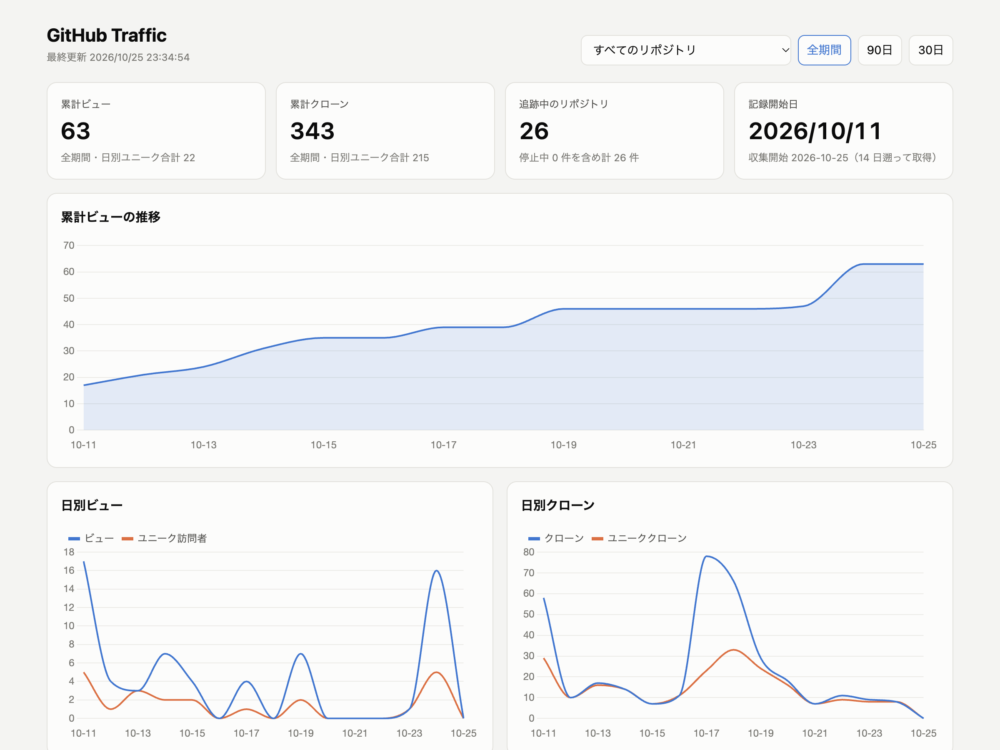
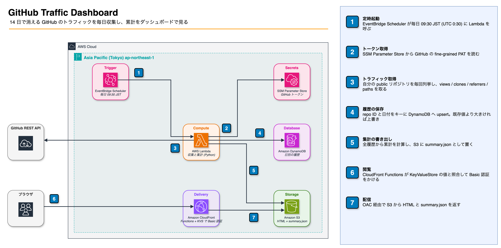

# GitHub Traffic Dashboard


GitHub の Insights → Traffic は、直近 14 日分しか見られません。
このアプリはトラフィックを毎日取得して DynamoDB に積み上げ、累計を CloudFront 上のダッシュボードに表示します。



## できること

- 自分がオーナーの public リポジトリのビュー数とクローン数を、日別に貯め続けます
- 追跡するリポジトリを登録する必要はありません。実行のたびに一覧を取り直すので、新しく作ったリポジトリや、private から public に切り替えたリポジトリも次の実行から対象になります
- public でなくなったリポジトリは収集を止めます。それまでの履歴は消さずに残ります
- 履歴はリポジトリ名ではなく ID で記録します。リネームしても履歴は途切れません
- ダッシュボードには Basic 認証をかけています

## 構成



構成図の PNG には draw.io のデータを埋め込んであります。[draw.io](https://app.diagrams.net/) で開けば、そのまま編集できます。

| ディレクトリ | 中身 |
|---|---|
| [`lib/`](lib/) | CDK スタック（TypeScript） |
| [`lambda/collector/`](lambda/collector/) | 収集と集計を行う Lambda（Python、標準ライブラリと boto3 のみ） |
| [`functions/`](functions/) | Basic 認証を行う CloudFront Functions |
| [`web/`](web/) | ダッシュボード（HTML 1 枚、グラフは Chart.js） |
| [`scripts/`](scripts/) | GitHub トークンと Basic 認証の資格情報を AWS に登録するスクリプト |

## 収集するデータ

| 項目 | API | 保存のしかた |
|---|---|---|
| ビュー数・ユニーク訪問者数 | `GET /repos/{owner}/{repo}/traffic/views` | 日別に保存。同じ日のデータが既にあれば、大きいほうを残す |
| クローン数・ユニーククローン数 | `GET /repos/{owner}/{repo}/traffic/clones` | 同上 |
| 参照元 | `GET /repos/{owner}/{repo}/traffic/popular/referrers` | 直近 14 日の集計を、日ごとのスナップショットとして保存 |
| 人気ページ | `GET /repos/{owner}/{repo}/traffic/popular/paths` | 同上 |

GitHub が返す当日の値は途中経過です。翌日以降の実行で、確定した値に上書きされます。

> [!NOTE]
> GitHub はユニーク数を日別にしか返しません。ダッシュボードの「ユニーク」は日別ユニーク数を足したもので、同じ人が別の日に来ると重複して数えます。期間全体の実人数ではありません。
> 参照元と人気ページは、GitHub が「直近 14 日の集計」としてしか返さないため、累計はありません。

## 必要なもの

- Node.js 20 以上
- AWS アカウントと認証情報（CDK bootstrap 済みであること）
- GitHub の fine-grained personal access token（手順 1 で作ります）

## セットアップ

以降のコマンドは、リポジトリのルートで実行します。AWS CLI はプロファイルの既定リージョンを使うため、最初にデプロイ先のリージョンを揃えておきます。

```bash
export AWS_REGION=ap-northeast-1
```

### 1. GitHub トークンを作る

次の URL を開くと、名前と権限が入った状態で作成画面が開きます。`<YOUR_USER>` は自分の GitHub ユーザー名に置き換えてください。

```
https://github.com/settings/personal-access-tokens/new?name=github-traffic-dashboard&description=Read+traffic+of+public+repositories&target_name=<YOUR_USER>&expires_in=365&administration=read
```

| 項目 | 設定 |
|---|---|
| Repository access | **All repositories**。特定のリポジトリに絞ると、新しく作ったリポジトリを追跡できません |
| Repository permissions | **Administration: Read-only** だけで足ります。Traffic API がこの権限を要求します（[公式ドキュメント](https://docs.github.com/en/rest/authentication/permissions-required-for-fine-grained-personal-access-tokens)）。Metadata: Read-only は自動で付きます |
| Expiration | 365 日 |

> [!WARNING]
> GitHub のドキュメントには有効期限を最長 366 日まで指定できると書かれています。しかし実際には、365 日を超えると `exceeds the allowed limit of 365 days` と表示され、作成できませんでした（2026-10-25 時点）。
> トークンが切れると収集が止まります。GitHub には 14 日分のデータが残るため、切れてから 14 日以内に作り直して手順 3 をやり直せば、データは欠けません。

### 2. デプロイする

```bash
npm install
npx cdk deploy
```

デプロイ先のリージョンは、AWS プロファイルの設定ではなく環境変数 `DEPLOY_REGION` で決まります。指定しなければ `ap-northeast-1` です。別のリージョンにする場合は、`DEPLOY_REGION` と `AWS_REGION` を同じ値にしてください。

```bash
export DEPLOY_REGION=us-east-1 AWS_REGION=us-east-1
npx cdk deploy
```

### 3. GitHub トークンを登録する

トークンは SSM Parameter Store に SecureString として保存します。シェルの履歴に残らないよう、`read -s` で入力します。

```bash
read -rs GITHUB_TRAFFIC_TOKEN && export GITHUB_TRAFFIC_TOKEN
./scripts/put-github-token.sh
unset GITHUB_TRAFFIC_TOKEN
```

1 行目を実行すると入力待ちになります。トークンを貼り付けて Enter を押してください。入力した文字は画面に表示されません。

<details>
<summary>1Password CLI を使う場合</summary>

`.env.op` の参照先を自分の 1Password の項目に合わせてから、次のように実行します。この方法は動作確認していません。

```bash
op run --env-file .env.op -- ./scripts/put-github-token.sh
```

</details>

### 4. Basic 認証を設定する

```bash
./scripts/set-basic-auth.sh
```

パスワードを指定しなければ、スクリプトがランダムに生成します。生成したパスワードは SSM Parameter Store の `/github-traffic/basic-auth-password` に保存されます。ユーザー名は `admin` です。どちらも環境変数 `BASIC_AUTH_USER` と `BASIC_AUTH_PASSWORD` で指定できます。

パスワードは次のコマンドで確認できます。

```bash
aws ssm get-parameter --name /github-traffic/basic-auth-password \
  --with-decryption --query Parameter.Value --output text
```

### 5. 初回の収集を実行する

毎日の実行を待たずに一度動かすと、GitHub に残っている直近 14 日分が取り込まれます。

```bash
FUNCTION_NAME=$(aws cloudformation describe-stacks --stack-name GithubTrafficStack \
  --query "Stacks[0].Outputs[?OutputKey=='CollectorFunctionName'].OutputValue" --output text)
aws lambda invoke --function-name "$FUNCTION_NAME" /dev/stdout
```

`{"repos": 26, "failed": []}` のように、対象のリポジトリ数と失敗したリポジトリの一覧が返ります。

ダッシュボードの URL は、デプロイ時に出力される `DashboardUrl` です。後から確認するときは次のコマンドを使います。

```bash
aws cloudformation describe-stacks --stack-name GithubTrafficStack \
  --query "Stacks[0].Outputs[?OutputKey=='DashboardUrl'].OutputValue" --output text
```

## 設定

`cdk.json` の `context` で変更できます。

| キー | 既定値 | 内容 |
|---|---|---|
| `githubTokenParameterName` | `/github-traffic/token` | トークンを保存する SSM パラメータの名前 |
| `scheduleExpression` | `cron(30 0 * * ? *)` | 収集を実行する時刻（UTC）。GitHub の日付は UTC で区切られるため、UTC の日付が変わった直後に実行しています |

## 片付け

```bash
npx cdk destroy
```

収集した履歴を守るため、DynamoDB テーブルは削除ポリシーを `RETAIN` にしています。スタックを削除してもテーブルは残るので、不要ならコンソールから削除してください。SSM Parameter Store の 2 つのパラメータ（`/github-traffic/token` と `/github-traffic/basic-auth-password`）も手動で削除します。

## コスト

個人のリポジトリが数十件程度なら、DynamoDB・Lambda・S3・EventBridge Scheduler の料金は、ほぼ無料枠に収まります。CloudFront も、個人で眺める程度のアクセスなら無料枠の範囲です。実際の請求額は利用状況によって変わるため、必要に応じて AWS Budgets などで確認してください。

## 動作確認した環境

2026-10-25 に、ap-northeast-1 でセットアップの手順 1〜5 を通して実行しました。

| 項目 | バージョン |
|---|---|
| Node.js | 26.12.0 |
| aws-cdk-lib | 2.274.0 |
| AWS CDK CLI | 2.1146.1 |
| Lambda ランタイム | Python 3.13（arm64） |

## ライセンス

[MIT](LICENSE)
